# Skeletons and rigging of the 3D monsters (audit and new method)

Lane rigaudit, 2026-11-21. Scope: the step of the monster3d pipeline that binds a generated mesh to a donor D2R
skeleton (`tools/sprite3d/rig_fit.py`, called by `monster3d/s5_build.py`), and how the donor's clips are applied to the
result. Test case: the Glowing Fungus (`2(`, donor Dried Corpse `mummy1`), stage `5-r13x` of lane fungus13.
Everything was judged in the viewer and with numbers. There was no game run.

Run folder: `/d2work/runs/rigaudit/` (stages under `ev/fungus/stages/`, audit images under `audit/`, measures under
`measure/`, sheets under `sheets/`).

## Summary

The owner's suspicion was right. The rig caused the "short lumpy arm blobs", the "legs as one column", much of the
crumpling, and nearly all of the limb stretch in the clips. Four defects, in order of harm:

1. **The mesh was squeezed into the donor's proportions.** rig_fit carried every vertex into the donor's T-pose at the
   donor's joint positions. The Fungus' arm is 2.3x (upper arm) and 2.7x (forearm) the Dried Corpse's. The `stretch`
   clamp (`smin 0.7`) shortened each arm segment to 0.7, and the rest of the arm length folded into the wrist and
   shoulder. The result is the short blob arms.
2. **The weights bled across air.** They were Euclidean capsule proximity with fixed radii (sized for the Wereowl).
   The Fungus' hands hang next to its thighs, so hand vertices took thigh/calf weight and thigh vertices took wrist
   weight. In the bind pose this produced a sheet of skin from the shoulder down to the knee.
3. **Each segment's far half belonged to the child bone.** Segment weight was split linearly between the start and
   end joints, so the middle of the thigh followed the calf. Only 32 (left) and 55 (right) LOD0 vertices had a thigh
   weight above 0.5. Clavicles and spine_02 owned none. The legs bent as one block from the hip, which reads as a
   column.
4. **The joint table was hand-typed guesses.** On average the joints sat 0.5 units from where the mesh's medial axis
   puts them (shoulders 1.0, clavicles 0.7, spine 0.4–0.6). That made the segments, and so items 2 and 3, worse.

All four are fixed by a new tool, `monster3d/rig_embed.py`. It embeds the joints from the mesh's medial axis, uses
geodesic voxel weights, and binds the mesh in place with its own bone lengths, so the mesh is never squeezed into
the donor's pose or proportions. The donor clips are retargeted (own lengths, leg IK, head-anchored cog). Measured
against the generated mesh, limb stretch drops by 85–99 % on every clip except skill1, which drops 78 %. The cap
stays bit-identical: same stored vertices, and in every clip within 0.03 units of r13x's world position.

The silhouette IoU against classic is lower with the new rig (NU 0.739 → 0.671). The reason is that the true-length
arms and legs now show; the old squeeze kept short stubs inside classic's outline. Closing that gap is a pose
refit and mesh-proportion job, not a rig one (see "What the new rig does not fix").

## 1. Audit (stage 5-r13x)

Tools: `monster3d/rig_audit.py` (new).

- `posed` recovers the generated mesh exactly from any rig_fit stage: the per-vertex carry is affine, so it can be
  inverted (`rig_fit.uncarry`). Refitting the recovered mesh reproduces `5-r13x`'s positions to 9e-15 and its weights
  exactly, so these images show the rig as it was built.
- `sheets` draws the rig.
- `stretch` reports, per clip, the worst sample by bone. With `--ref` it measures against the generated mesh rather
  than the bind.
- `iou` measures silhouette and cap IoU against classic for every mode, from the clips as written.

### Joints: the hand-typed table

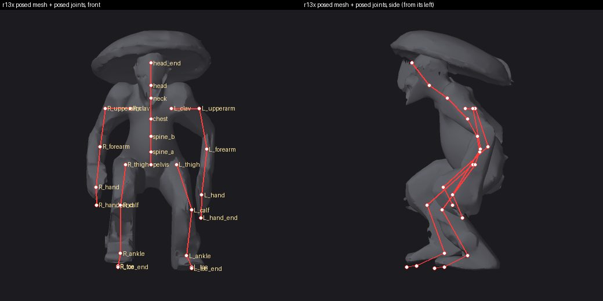

The profile's `posed` joints over the mesh. The shoulders sit at the top of the shoulder mass, about 1 unit from its
centre. The pelvis and spine run along the belly surface. Hands and feet are near the right places.

### Bind pose: the mesh squeezed into the donor's T-pose

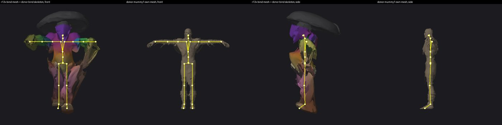

Left: r13x's bind mesh (weight colours) on the donor skeleton. Right: the Dried Corpse's own mesh on the same
skeleton. The arms end at about 60 % of the donor's span: those are the blobs at the shoulders. On the left side, an
olive sheet hangs from the shoulder to the knee: hand vertices with leg weight, averaged between a T-pose hand and a
leg. The legs merge into one skirt.

| segment | posed length | donor bind length | applied scale |
|-|-|-|-|
| upper arm | 1.47–1.52 | 0.96 | 0.70 (clamped, wanted 0.63–0.65) |
| forearm | 1.95–2.18 | 1.13 | 0.70 (clamped, wanted 0.52–0.58) |
| spine_b | 0.74 | 0.50 | 0.70 (clamped) |
| thigh | 2.11–2.22 | 1.99 | 0.89–0.94 |

The girth was scaled by 0.70^0.35 = 0.88 as well.

### Weights

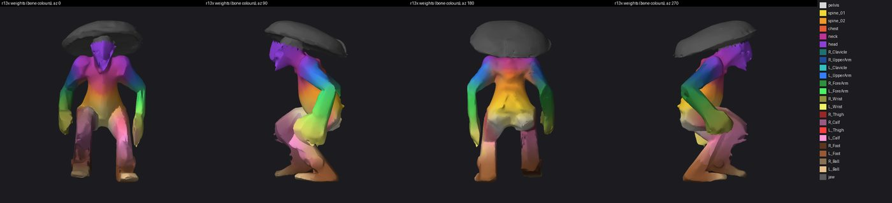

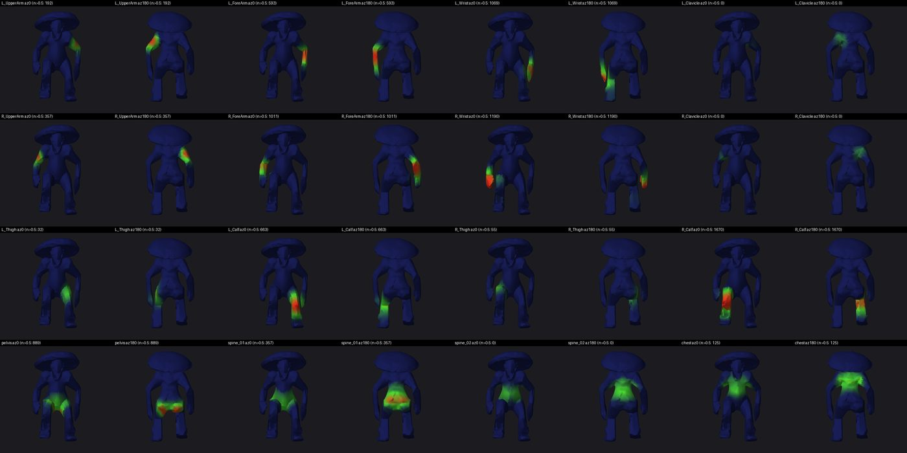

Per-bone heat maps (red = 1). In the `L_Wrist` row the wrist's weight continues onto the left calf (back view). The
thigh columns show almost no red: the thigh owns 32 / 55 vertices above 0.5, while the calf owns 663 / 1670. Clavicle
and spine_02: 0.

### Where the clip stretch comes from

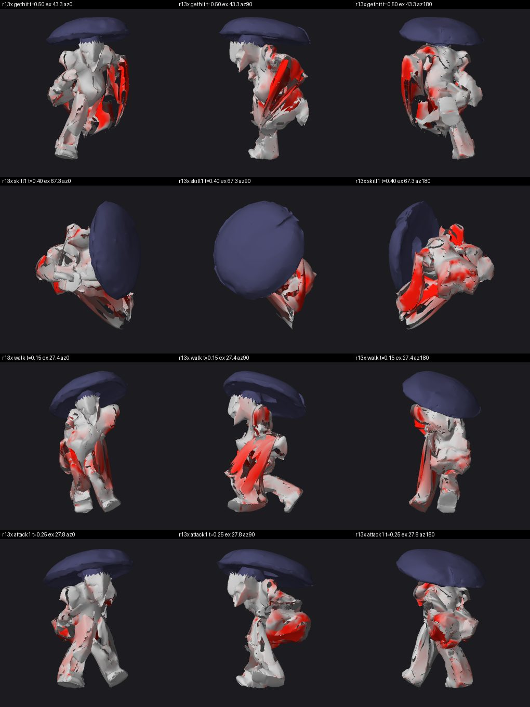

The worst sample of gethit, skill1, walk and attack1, with each vertex coloured by its most stretched edge (white 1.0,
red ≥ 2.0). The red sheets run between hand and thigh. By bone (excess against the bind): gethit's 43 is L_Wrist 22,
L_Calf 7, L_Thigh 5. skill1's 67 is pelvis 15, R_Calf 9, R_Thigh 8, L_Wrist 7. walk's 27 is L_Calf 6, L_Thigh 3,
L_Foot 3.

These numbers are measured against r13x's bind, which is itself the squeezed mesh. Measured against the generated
mesh, r13x's clips stretch 56–145 (table in section 3).

### Clips and proportions

The donor clips carry a translation track for every bone, equal to the donor's bone lengths. The unit JSON loads the
donor's `.skeleton`. So whatever the mesh's proportions are, the clips force the donor's lengths. This is why rig_fit
had to squeeze the mesh, and why a rig with the mesh's own lengths needs its clips retargeted.

## 2. The new method: `monster3d/rig_embed.py`

The module docstring has the details. In short:

1. **Embed** (`rig_embed.py embed`):
   - The posed mesh is voxelised at height / 190 and filled solid. Small holes are closed first. `--volume` takes the
     closed LOD0 when the stage's LOD0 is open, e.g. after the cap split. The rigid part is cut off.
   - Inside the volume, a shortest-path graph weighted by 1 / EDT² makes paths run along the medial axis.
   - From the thickest trunk voxel, the geodesic extremities are found and named: head = the highest; per side, the
     toe = the lowest, most forward tip, and the hand = the farthest remaining tip.
   - Joints are placed on the smoothed medial paths:
     - Shoulder, elbow, knee and ankle at the sharpest bends in fixed ranges of each limb path.
     - Wrist and ball at the donor's ratios.
     - Hips where the leg path narrows and leaves the spine path. The pelvis sits between them.
     - Chest where the arms branch off.
     - The head joint is the profile's when a rigid part rides on it.
   - `--png` draws the joints and paths.

   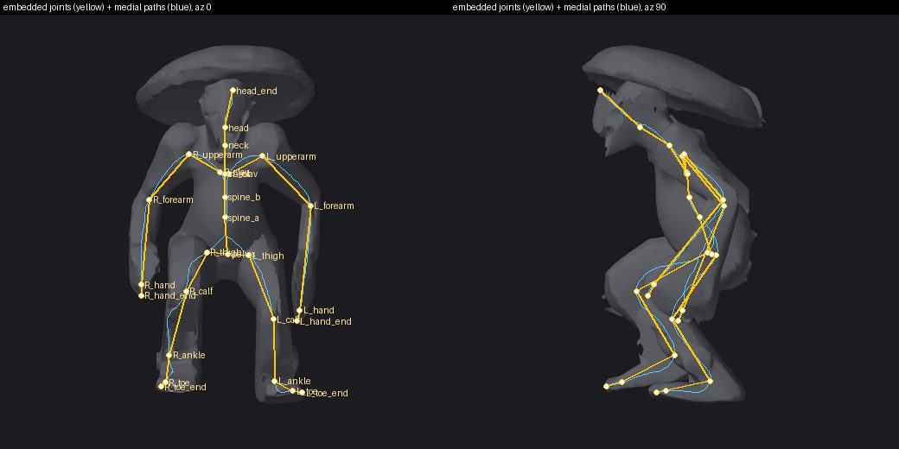

2. **Weights** (in `build`): geodesic voxel binding (as in Dionne & de Lasa, "Geodesic voxel binding", SCA 2013).
   - Each bone owns the medial path between its joint and its child's.
   - A vertex's in-volume distance to each bone (Dijkstra over the voxels) gives w ∝ 1 / (d + h)^4. The top 4 are
     kept, with 2 smoothing passes over the mesh edges.
   - Paths cannot cross air, so the hands keep their arm weights and the legs stay apart wherever the mesh has a gap.
   - The thigh now owns 939 / 1403 vertices above 0.5. The wrist owns only the hands.

   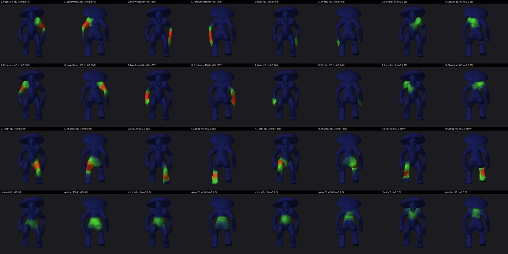

3. **Bind in place** (in `build`): the mesh is not moved.
   - The bind pose is the donor's skeleton posed into the mesh. Each mapped bone gets the minimal turn from its donor
     direction to the embedded one, with the embedded length.
   - The head keeps rig_fit's carry frame. The cap's bone (`jaw`) and the corpse shell's (`loin_cloth`) keep the
     donor bind, so cap and shell vertices are copied byte for byte.
   - The models get this skeleton (rest transforms and inverse world transforms). The unit gets its own
     `fungus.skeleton` with the same skeleton.
   - The donor-convention clips are kept as `<stage>/clips_donor.animations`.

4. **Retarget** (`rig_embed.py retarget`, also run by `build`): from `clips_donor.animations` to the overlay, at
   60 samples a second.
   - Every mapped bone: translation = its embedded length.
   - Trunk and clavicles: the clip's motion relative to the donor's rest, added to ours (`--trunk delta`, the
     default). This keeps the Fungus' hunch. `--trunk world` takes the donor's lean instead.
   - Upper arms: the donor's world orientation.
   - Forearms and hands: the clip's local rotation.
   - Legs: two-bone IK onto the donor's ankle path. The target is offset by the hip and ankle-height differences, the
     knee bends in the donor's knee plane, and the foot keeps the donor's world rotation.
   - Head (rigid part on it): the donor clip's world orientation. The turn that needs is spread over
     spine_a..neck, and the cog is moved each sample so that the head's world transform is exactly the donor
     clip's. The cap therefore moves as before.
   - Shell bone: its donor world transform.

5. **Fitting clips on the new rig**: `s5_clipfit.py` detects `rig.json`.
   - Its template still poses the donor skeleton; Rig retargets the pose and skins with the stage's own bind.
   - `write` writes `clips_donor.animations` and re-runs the retarget.
   - New option `--hold-lift-from <clip.json>` holds a clip's stored lifts. Use it when refitting on a rig_embed
     stage: recomputing the lift from the new feet would move the cap.

6. **Options left to the operator**:
   - `--body-scale s` scales the body (not the rigid part) uniformly about the head joint. This is a proportion
     choice with no distortion. Tried at 0.75–0.9 on the Fungus' NU: it moved IoU by −0.01 to +0.02, so it was not
     used.
   - `--power`, `--smooth`, `--trunk`.

### Bone lengths, new rig vs donor (bind units)

Each length runs from the parent's joint to this bone's joint.

| | upper arm | forearm | thigh | calf | spine (pelvis→chest) |
|-|-|-|-|-|-|
| donor (Dried Corpse) | 0.96 | 1.13 | 1.99 | 1.73 | 1.01 |
| Fungus, embedded | 1.95–2.17 | 2.98–3.05 | 2.20–2.27 | 1.96–2.06 | 2.31 |

### Downloads and licences

Nothing was downloaded and nothing was installed. The tool uses numpy, scipy and scikit-image from the existing
monster3d venv, and the repo's own GR2 code. Alternatives considered:

- **Blender bone heat.** Blender 4.5.9 is already at `/d2work/tools`; GPL-2.0-or-later, used as a tool only. Bone heat
  fails on non-manifold input, and TripoSG meshes after the cap split have about 1400 open edges. The voxel geodesic
  variant is the robust form of the same idea.
- **libigl bounded biharmonic weights** (MPL-2.0). They need a clean tetrahedral mesh of the same surface.
- **Learned auto-riggers** (RigNet, GPL-3.0; UniRig, MIT, as their repositories state, not re-checked). They predict
  their own skeletons rather than the donor's, which the D2R clips need, and they target CUDA, while this machine's
  GPU is ROCm.

## 3. Measures (Fungus: r13x vs new rig, stage `5-rigaudit`)

The new rig's NU is refitted (`clips/nu_rig2.json`): the r13 command with the hold and lift from `nu_v5` and arm
bounds widened to hanging. Every other clip is the same donor clip in both stages.

**Limb stretch.** Worst sample per clip: the sum over body edges of max(0, posed − 1.5 × reference), cap excluded.

| clip | r13x vs its bind | r13x vs generated mesh | new rig vs generated mesh (= its bind) |
|-|-|-|-|
| neutral | 6.87 | 82.86 | 1.21 |
| walk | 27.44 | 144.70 | 6.93 |
| attack1 | 27.78 | 85.82 | 6.46 |
| attack2 | 13.45 | 94.49 | 4.28 |
| gethit | 43.27 | 134.26 | 4.33 |
| skill1 | 67.32 | 143.49 | 31.01 |
| knockback | 17.40 | 55.78 | 14.35 |
| death | 24.06 | 108.02 | 1.26 |

`s5_stretch.py` on `5-rigaudit` gives the same numbers. What is left is in skill1, a donor clip in which the body lies
down and rolls (hip flexion at the buttocks, a limit of linear blend skinning), and in knockback (chest and clavicles,
where the head is held to the donor's motion).

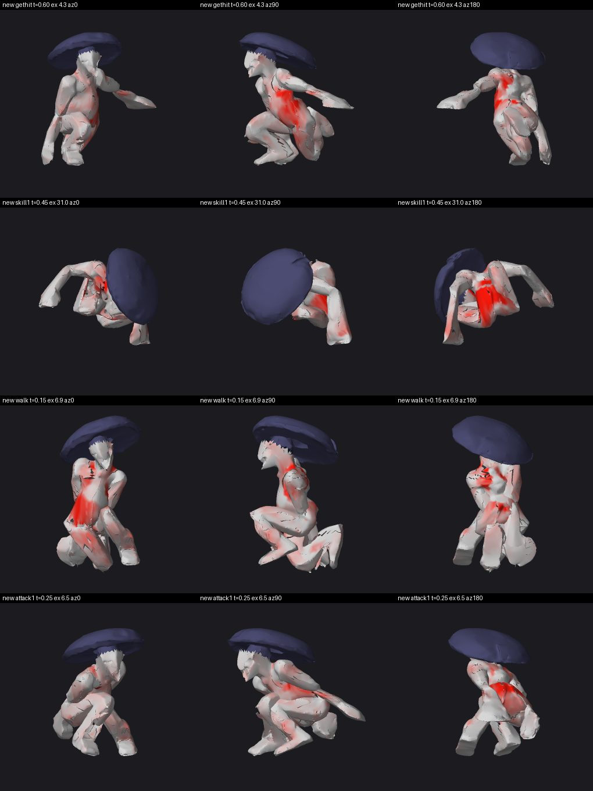

**Silhouette IoU against classic.** Median over frames × 8 facings, from the written clips.

| mode | r13x body | new body | r13x cap | new cap |
|-|-|-|-|-|
| NU | 0.739 | 0.671 | 0.927 | 0.927 |
| WL | 0.768 | 0.705 | 0.898 | 0.898 |
| A1 | 0.741 | 0.614 | 0.848 | 0.847 |
| A2 | 0.734 | 0.617 | 0.848 | 0.848 |
| GH | 0.695 | 0.562 | 0.902 | 0.902 |
| DT | 0.201 | 0.327 | 0.063 | 0.072 |

The NU fit measures are also unchanged where they should be: cap IoU 0.927, tilt error 2.3°, h/w 1.033.

**The cap.**
- Its 10,129 LOD0 vertices are byte-equal to r13x.
- Its world position in every clip is within 0.03 units of r13x's (max 0.029 in knockback, 0.000 in neutral, walk,
  gethit and dead). The residual is the 60 fps resampling.

**Sheet** (classic | r13x | new rig): `/d2work/runs/rigaudit/sheets/SHEET-rigaudit-classic-r13x-newrig.png`.

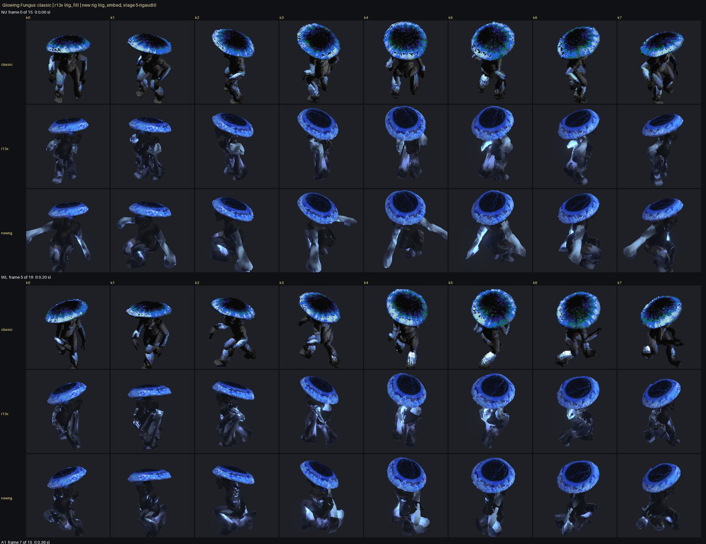

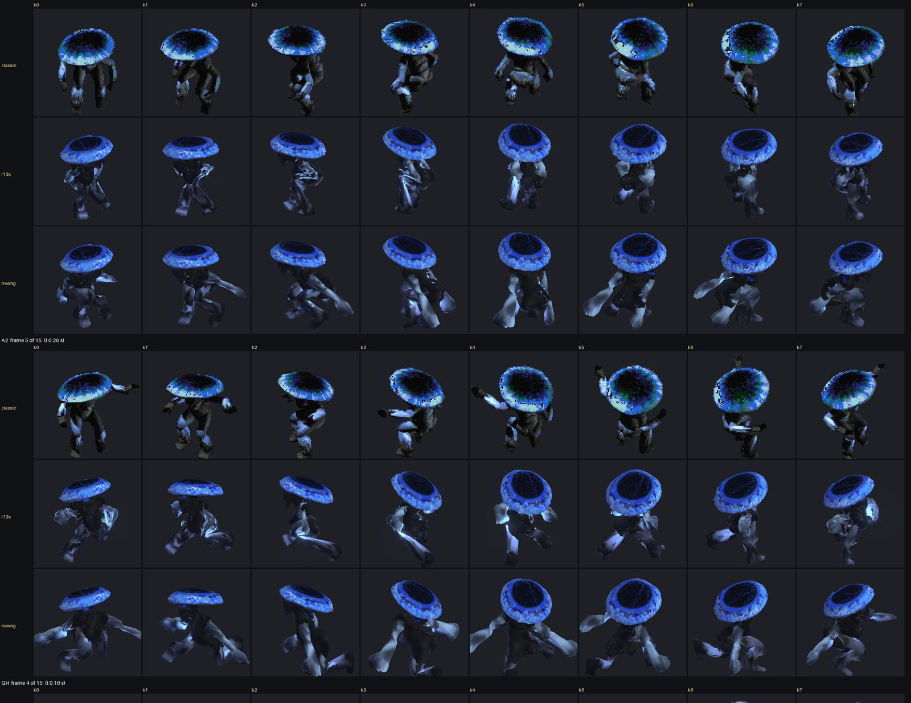

## What the new rig does not fix

- **Silhouettes against classic.**
  - In the donor clips (WL, A1, A2, GH, all unfitted) the long arms now swing as far as the donor's short ones did.
    The fix is to fit those modes on the new rig with `s5_clipfit.py`, as was done for NU.
  - In NU the refit only freed the limbs. Trunk, cog and lift were held from r12 so that the cap stays exactly where
    it is.
  - The outline sheet (classic grey, ours yellow; r13x left, new right) shows the rest of the gap: the hunched back
    and the wider stance.

  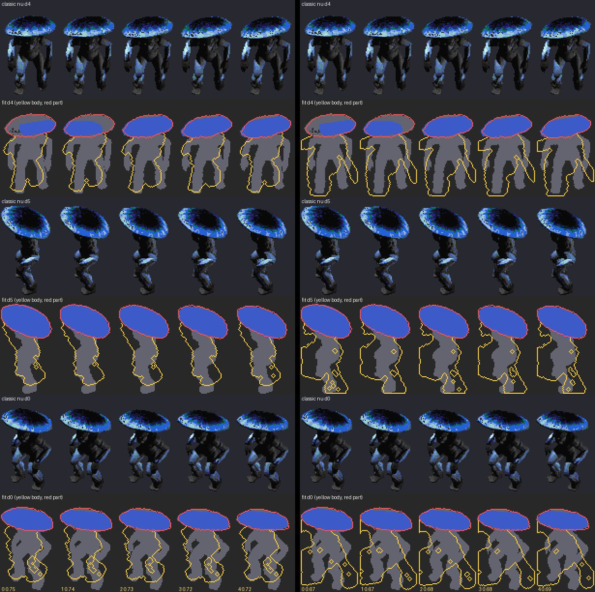

  Freeing the trunk would move the cap; that is the owner's call. Mesh proportions belong to the mesh stage.
- **In game: not checked.** The viewer skins with the model's skeleton. Both the model's skeleton and the unit's new
  `fungus.skeleton` are written the same way. Whether D2R takes the inverse world transforms from the model or from
  the unit skeleton is the first thing to check in a game run. The unit's `IKComponent` (foot IK, `defaultEnabled:
  false`) names the same bones.
- **Death clip.** `s5_death.py` builds its clip on the donor skeleton. On a rig_embed stage, run it before `rig_embed.py
  build`, or add its clip to `clips_donor.animations` and re-run `retarget`; running it after the build is not
  supported.
- **Crumpled surface.** This is the generated mesh itself. The rig no longer adds folds at joints, but the TripoSG
  surface keeps its own.

## Adopting it (any monster)

```
. <run env.sh>; M=/d2work/venv/monster3d/bin/python; cd tools/sprite3d/monster3d
# a built stage made by s5_build/rig_fit: recover the generated mesh (or use the stage's mesh_lods.npz directly)
$M rig_audit.py posed  --token T <stage> posed.npz
$M rig_embed.py embed  --token T posed.npz joints.json --volume <closed mesh_lods.npz> --png <dir>   # check the png
$M rig_embed.py build  --token T <stage> posed.npz joints.json <new stage>
$M s5_clipfit.py fit   --token T --mode nu <new stage> <classic> nu.json --hold <old nu.json> --hold-lift-from <old nu.json> ...
$M s5_clipfit.py write --token T <new stage> nu.json          # writes clips_donor.animations and retargets
$M rig_audit.py stretch --token T <new stage> out.json --ref posed.npz
$M rig_audit.py iou     --token T <new stage> <classic> out.json
```

Tests: `tools/tests/test_rig_embed.py`, run with the monster3d venv for all of them; the project venv skips the two
that need it. They check that the carry and its inverse round-trip, the clamp, and embedding on a synthetic crouching
biped (tips, elbows/knees within 0.45, shoulders within 0.5). They also check that a hand hanging next to a thigh stays
on the arm (> 97 % arm weight) and the leg stays on the leg, and that the two-bone IK keeps its lengths and reaches.
